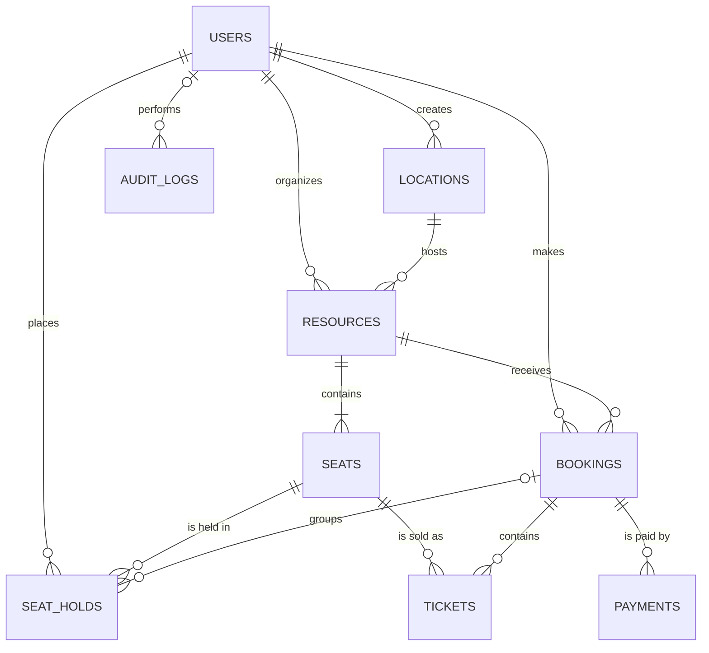
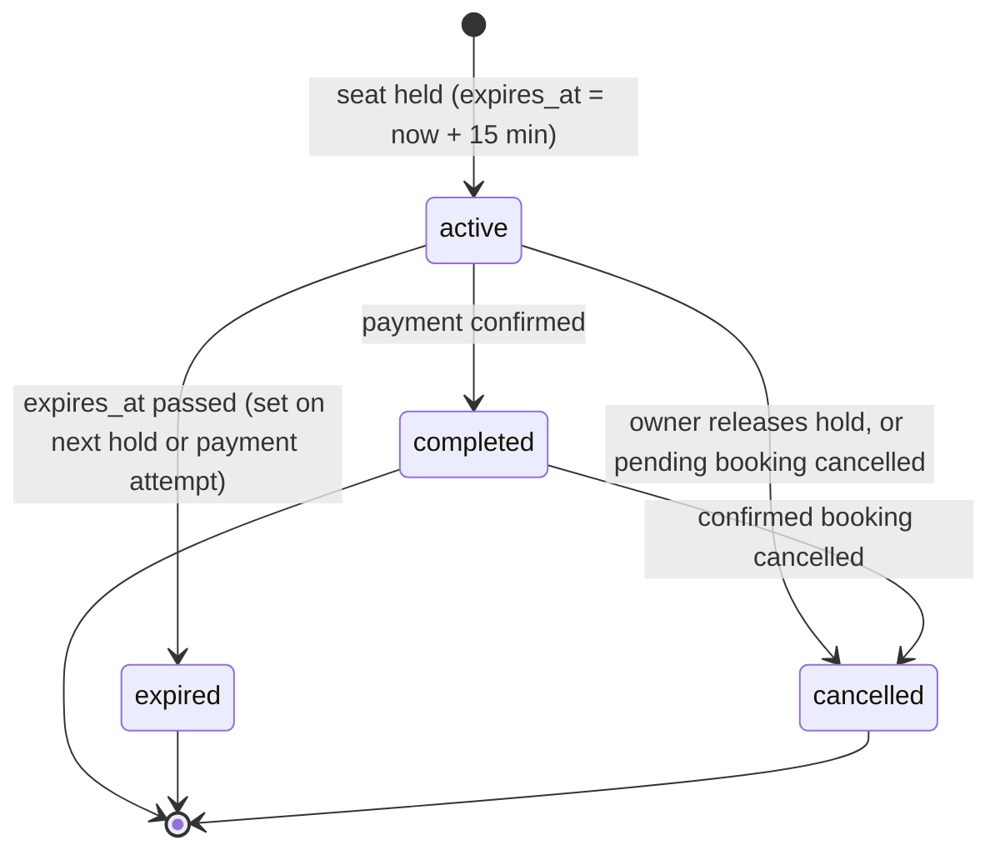

# RESERVIA – Ticket Booking REST API

**CSC4161 · Advance Programming in Web Technology · Fall 2026**
American International University-Bangladesh (AIUB)

A backend REST API for booking numbered seats for scheduled shows, trips and sessions. **Organizers** publish events (resources) at venues (locations). **Customers** browse events, hold a seat for 15 minutes, pay, and receive a ticket. **Admins** run the system and create organizer accounts. Two customers can never hold or buy the same seat, and a failed payment leaves no partial data.

- **Repository:** https://github.com/pronoyrahman/Reservia-Ticket-Booking-REST-API
- **Trello board:** https://trello.com/b/QGMluVEe/awtreserveflow
- **Stack:** NestJS 12 (ESM) · TypeScript · PostgreSQL · TypeORM · JWT · bcrypt
- **Database:** `reservia_db` (fixed name, do not change)
- **Frontend:** none. The API is demonstrated through Swagger UI and Postman.

> **This file is the single source of truth for the team.** Older READMEs (two-role version, "ReserveFlow", `awt project idea.md`) are out of date. If code and this file disagree, raise it in the group before changing either.

---

## Table of contents

1. [Team and ownership](#1-team-and-ownership)
2. [Roles and access rules](#2-roles-and-access-rules)
3. [Course requirement coverage](#3-course-requirement-coverage)
4. [Database design (9 tables)](#4-database-design-9-tables)
5. [Business rules](#5-business-rules)
6. [Transactions](#6-transactions)
7. [API endpoints](#7-api-endpoints)
8. [Response format, validation and errors](#8-response-format-validation-and-errors)
9. [Coding conventions](#9-coding-conventions)
10. [Project structure](#10-project-structure)
11. [Environment configuration](#11-environment-configuration)
12. [Installation and running](#12-installation-and-running)
13. [Git workflow](#13-git-workflow)
14. [Testing and demo checklist](#14-testing-and-demo-checklist)
15. [Open tasks by member](#15-open-tasks-by-member)
16. [Work plan and status](#16-work-plan-and-status)
17. [Report checklist](#17-report-checklist)
18. [Design decisions log](#18-design-decisions-log)
19. [Rules for contributors and AI assistants](#19-rules-for-contributors-and-ai-assistants)

---

## 1. Team and ownership

| Member | Role | Branch | Modules | Bonus features |
| --- | --- | --- | --- | --- |
| Pronoy Rahman | Dev 1 (Lead) | `pronoy` | Users (incl. creating organizers), Auth, global guards, `@Public()`, `@CurrentUser()`, global exception filter, admin seed, **Seat holds (T3)** | Middleware, Custom decorators, Env (Joi), Swagger, Migrations |
| Walid Bhuiyan | Dev 2 | `walid` | Locations, Resources, Seats, organizer ownership checks, seat map, pagination | Interceptors, Response manipulation, Database transaction (advanced) |
| Rafsan | Dev 3 | `rafsan` | Bookings (incl. organizer view), Tickets (incl. check-in), Payments | Mailer, Audit log |

Every member must be able to explain every module at the demo, not only their own, and **every member's own work must meet all five minimum requirements (§3.3)**.

---

## 2. Roles and access rules

The project uses **three roles**. The course minimum is two; the organizer role adds ownership rules (organizer B cannot change organizer A's event).

| Role | How the account is created | Allowed actions |
| --- | --- | --- |
| `admin` | Created automatically at start-up from `SEED_ADMIN_EMAIL` / `SEED_ADMIN_PASSWORD`, or by another admin through `POST /users/create-user` | Manage all users and **create organizer accounts**. Create, edit and delete any location, resource or seat. View all holds, bookings, tickets, payments and the audit log. Cancel any booking (the mock refund is automatic, BR-09) and check tickets in. |
| `organizer` | **Only by an admin**, through `POST /users/create-user` with `"role": "organizer"` | Create locations (venues) and resources (events) with seats. Edit, block or delete **only their own** locations, resources and seats. View bookings of their own resources. Check tickets in for their own resources. |
| `customer` | Self-registration through `POST /auth/register` | Browse locations, resources and seat maps. Hold seats, create and pay for bookings, cancel own bookings. View own holds, bookings and tickets. |
| Public (no token) | — | Register, log in, browse locations, resources and seat maps. |

### 2.1 Permission matrix

| Action | Admin | Organizer | Customer | Public |
| --- | --- | --- | --- | --- |
| Browse locations, resources, seat maps | ✅ | ✅ | ✅ | ✅ |
| Create a location | ✅ | ✅ (becomes owner) | ❌ | ❌ |
| Edit or delete a location | ✅ any | ✅ own only | ❌ | ❌ |
| Create a resource (event) | ✅ | ✅ (becomes organizer) | ❌ | ❌ |
| Edit or delete a resource | ✅ any | ✅ own only | ❌ | ❌ |
| Add, edit, block or delete seats | ✅ any | ✅ on own resources only | ❌ | ❌ |
| Hold seats, book, pay, cancel own booking | ❌ | ❌ | ✅ | ❌ |
| View bookings | ✅ all | ✅ of own resources | ✅ own | ❌ |
| Check a ticket in (`used`) | ✅ any | ✅ for own resources | ❌ | ❌ |
| Manage users, create organizers | ✅ | ❌ | ❌ | ❌ |
| Read the audit log | ✅ | ❌ | ❌ | ❌ |

"Own only" means: trying it on someone else's record returns **403 Forbidden**.

### 2.2 Rules

- The role always comes from the verified JWT. It is never read from a request body.
- `POST /auth/register` always creates a `customer`. The `role` field is not in the register DTO, so the whitelist rejects it (400). Nobody can make themselves an organizer or an admin.
- The current user's id is always taken from the token with `@CurrentUser()`. `userId`, `organizerId` and `createdById` are never accepted in a request body.
- Ownership is checked in the service layer, not only by role: the service loads the record and compares its owner with the caller's id (admins skip this check).
- Any organizer may hold an event at any **active** location, but only the location's owner (or an admin) may edit or delete it.

---

## 3. Course requirement coverage

### 3.1 Minimum requirements (all five are mandatory)

| # | Requirement | How Reservia meets it | Evidence for the demo | Owner |
| --- | --- | --- | --- | --- |
| 1 | Multiple entities with CRUD endpoints | 9 related entities. Full CRUD on users, locations, resources and seats. 201 on create, 404 when missing, pagination on every list. | Postman or Swagger run through every CRUD route | All |
| 2 | Database integration and data transaction | PostgreSQL through TypeORM with foreign keys. Payment confirmation writes 4 tables in one transaction and rolls back when a step fails. Every member also owns one transaction (§3.3). | pgAdmin tables; rollback demo (§6.1) | All (§3.3) |
| 3 | Authentication and authorization with JWT | Register and login, bcrypt hashes, global `JwtAuthGuard` and `RolesGuard`, three roles, ownership checks. | Login response; 401 without token; 403 for the wrong role; 403 when organizer B edits organizer A's event | Pronoy (auth), Walid (ownership) |
| 4 | Input validation with DTOs | Separate create and update DTOs with class-validator. Global `ValidationPipe` with `whitelist` and `forbidNonWhitelisted`. | Invalid body → 400 naming the field | All |
| 5 | HTTP exception handling | Built-in exceptions, one global error shape (`AllExceptionsFilter`), duplicate key → 409, foreign key in use → 409, no stack traces. | 404, 409 and 403 responses with a readable body | Pronoy (filter), all (services) |

### 3.2 Bonus features (10 of 10, each doing real work)

| # | Feature | What we build | Where it does real work | Owner |
| --- | --- | --- | --- | --- |
| 1 | Middleware | `RequestIdMiddleware` (sets `X-Request-Id`) and `RequestLoggerMiddleware` (method, path, status, duration) | Every request; the request id appears in error bodies and audit rows | Pronoy |
| 2 | Custom decorators | `@Roles()`, `@Public()`, `@CurrentUser()` | Role checks, public browse routes and optional-token seat map, owner lookups in every write | Pronoy |
| 3 | Mailer | `@nestjs-modules/mailer` + nodemailer + Handlebars templates, Mailtrap sandbox | Welcome email on register; booking confirmation with ticket numbers; cancellation notice | Rafsan |
| 4 | Swagger UI | `@nestjs/swagger` at `/api/docs`, `@ApiTags`, `@ApiProperty`, bearer auth | All modules; the API table in §7 must match Swagger | Pronoy |
| 5 | Interceptors | `ResponseInterceptor` (envelope) and `TimingInterceptor` (adds `X-Response-Time`, logs slow requests) | Every route | Walid |
| 6 | Audit log | `audit_logs` table written by an `AuditInterceptor` for every create, update and delete | Price changes, role changes, cancellations, refunds, check-ins; read at `GET /audit-logs` | Rafsan |
| 7 | Env | `@nestjs/config` + Joi schema, `.env.example` committed, app refuses to start if a variable is missing | Database, JWT, booking rules, seed admin, mail | Pronoy |
| 8 | Migrations | TypeORM CLI `data-source.ts`, generated migration files, `synchronize: false` in the final version | Builds all 9 tables, indexes and constraints on an empty database | Pronoy |
| 9 | Response manipulation | `{ success, message, data, meta }` envelope, pagination `meta`, `password_hash` never returned | Every success response | Walid |
| 10 | Database transaction (advanced) | Manual `QueryRunner` commit and rollback, `pessimistic_write` row locks, five transactional workflows (§6) | Resource + seats creation, seat add/delete, seat hold, booking, payment, cancellation | Walid, Rafsan, Pronoy |

### 3.3 Minimum requirements per member

Every member must meet **all five** minimum requirements **in their own modules**, so each person can show them at the demo and in the report. This is how the work is split:

| # | Requirement | Pronoy | Walid | Rafsan |
| --- | --- | --- | --- | --- |
| 1 | CRUD + pagination + 201/404 | **Users**: create, list (paginated, `role`/`search`), get, PUT, PATCH, DELETE | **Locations** (and Resources, Seats): create, list (paginated), get, PUT, PATCH, DELETE | **Bookings**: create, list (paginated), get, PATCH cancel, DELETE pending booking (BR-09) |
| 2 | Transaction with rollback | **T3 Hold a seat** (`seats` + `seat_holds`) | **T1 Create resource with seats** (`resources` + `seats`); T2 | **§6.1 Pay for a booking** (4 tables) with the rollback demo flag; T4, T5 |
| 3 | JWT + roles + guards | Built the auth, guards, `@Roles()`, `@Public()`; `/users` admin-only; holds customer-only with owner check (403) | `@Roles(Role.Admin, Role.Organizer)` on writes, `@Public()` on browse, organizer ownership (403) | `@Roles(Role.Customer)` on create/pay, owner checks (403), organizer view |
| 4 | Create/Update DTOs + 400 | `CreateUserDto`, `UpdateUserDto`, `GetUsersQueryDto`, `CreateHoldDto` | `CreateLocationDto`, `UpdateLocationDto`, resource and seat DTOs | `CreateBookingDto`, `CreatePaymentDto`, query DTOs |
| 5 | Exceptions 404/409/403 | Global filter; 404 user, 409 email, 409 seat taken / limit | 404, 409 duplicate / in use, 403 not owner | 404, 409 expired / not pending / too late, 403 not owner |

**Rollback proof for each transaction** (show in pgAdmin at the demo):

| Member | How to show the rollback |
| --- | --- |
| Pronoy (T3) | Two customers hold the same seat at the same moment: one gets 201, the other 409, and only one `active` hold row exists. |
| Walid (T1) | Create a resource where seat creation fails (e.g. a duplicate seat number forced in development): no resource row and no seat rows are saved. |
| Rafsan (§6.1) | `DEMO_FAIL_AFTER_TICKET_INSERT=true`: 500, and no payment, ticket, booking or hold change remains. |

---

## 4. Database design (9 tables)

### 4.1 Design principles

- Every table has `id` (`SERIAL`, primary key), `created_at` and `updated_at` (`timestamptz`, UTC).
- Database column names are **snake_case** and exactly as written in the tables below. No table prefix: `users.email`, not `users.user_email`.
- TypeScript entity properties are **camelCase** and map to the column with `@Column({ name: '...' })`.
- Entity class names are plural PascalCase: `Users`, `Locations`, `Resources`, `Seats`, `SeatHolds`, `Bookings`, `Tickets`, `Payments`, `AuditLogs`.
- Money is `numeric(10,2)` and is returned in JSON as a string, for example `"850.00"`.
- A **resource** is one scheduled offering with a date and time: a concert, a film screening, a bus trip, a seminar. Its seats belong to that offering only, so the same physical seat on a different day is a different seat row.
- Status and role values are lower-case strings in `varchar` columns, validated with TypeScript enums in `src/common/enums/`.

### 4.2 Entity relationship diagram



### 4.3 Relationships

| # | Relationship | Cardinality | On delete | Meaning |
| --- | --- | --- | --- | --- |
| R1 | users → locations (`created_by`) | 1 : N | RESTRICT | The admin or organizer who created a location owns it. |
| R2 | users → resources (`organizer_id`) | 1 : N | RESTRICT | An organizer owns many resources; each resource has one organizer. |
| R3 | locations → resources | 1 : N | RESTRICT | A location hosts many resources. A location in use cannot be deleted (409). |
| R4 | resources → seats | 1 : N | CASCADE | A resource has its own seats. |
| R5 | users → seat_holds | 1 : N | RESTRICT | A customer places many holds over time. |
| R6 | seats → seat_holds | 1 : N | RESTRICT | A seat is held many times over its life, but at most once actively. |
| R7 | bookings → seat_holds | 0..1 : N | SET NULL | A booking groups the holds it pays for. A new hold has no booking yet. |
| R8 | users → bookings | 1 : N | RESTRICT | A customer makes many bookings. |
| R9 | resources → bookings | 1 : N | RESTRICT | A booking is for exactly one resource. |
| R10 | bookings → tickets | 1 : N | RESTRICT | One ticket per seat in the booking. |
| R11 | seats → tickets | 1 : N | RESTRICT | A seat can be sold again after a cancellation, but has at most one valid ticket. |
| R12 | bookings → payments | 1 : N | RESTRICT | A booking may have several payment attempts. |
| R13 | users → audit_logs | 0..1 : N | SET NULL | Who performed the change; system actions have no user. |
| **M:N 1** | users ↔ seats through `seat_holds` | M : N | — | One customer holds many seats; one seat is held by many customers over time. |
| **M:N 2** | bookings ↔ seats through `tickets` | M : N | — | One booking covers many seats; one seat appears in many bookings over time. |

The two many-to-many relationships satisfy the course guide's request for at least one one-to-many and one many-to-many relationship.

### 4.4 Table details

#### Table 1: `users` (Pronoy)

| Column | Type | Constraint |
| --- | --- | --- |
| id | SERIAL | PK |
| name | varchar(100) | NOT NULL |
| email | varchar(150) | NOT NULL, UNIQUE |
| password_hash | varchar(255) | NOT NULL, `select: false`, never returned |
| phone_number | varchar(20) | NULL |
| role | varchar(20) | NOT NULL: `admin`, `organizer` or `customer`; default `customer` |
| is_active | boolean | NOT NULL, default `true`; `false` blocks login |
| created_at / updated_at | timestamptz | NOT NULL |

#### Table 2: `locations` (Walid)

| Column | Type | Constraint |
| --- | --- | --- |
| id | SERIAL | PK |
| created_by | int | NOT NULL, FK → users.id, ON DELETE RESTRICT; owner, taken from the token |
| name | varchar(150) | NOT NULL |
| city | varchar(100) | NOT NULL |
| address | text | NOT NULL |
| latitude | numeric(10,6) | NULL, between -90 and 90 |
| longitude | numeric(10,6) | NULL, between -180 and 180 |
| is_active | boolean | NOT NULL, default `true`; `false` blocks new resources here |
| created_at / updated_at | timestamptz | NOT NULL |
| deleted_at | timestamptz | NULL; set by soft delete |
| — | — | UNIQUE `(name, address)` |

`name` alone is not unique, because one venue brand can have several branches in the same city (for example two "Star Cineplex" halls in Dhaka). The address tells them apart. The unique rule also counts soft-deleted rows, so a deleted location's name + address cannot be used again (409); this is intended (D14).

#### Table 3: `resources` (Walid)

| Column | Type | Constraint |
| --- | --- | --- |
| id | SERIAL | PK |
| organizer_id | int | NOT NULL, FK → users.id, ON DELETE RESTRICT; taken from the token |
| location_id | int | NOT NULL, FK → locations.id, ON DELETE RESTRICT |
| name | varchar(150) | NOT NULL (e.g. `Rock Night 2026`, `Dhaka → Sylhet 08:00`) |
| type | varchar(30) | NOT NULL: `concert`, `movie`, `bus`, `seminar`, `other` |
| starts_at | timestamptz | NOT NULL |
| ends_at | timestamptz | NOT NULL, CHECK `ends_at > starts_at` |
| seats_per_row | int | NOT NULL, default `10`, CHECK `> 0` |
| capacity | int | NOT NULL, CHECK `> 0`, max `260`; always equals the number of seat rows |
| price_per_ticket | numeric(10,2) | NOT NULL, CHECK `>= 0` |
| is_available | boolean | NOT NULL, default `true`; `false` closes sales |
| created_at / updated_at | timestamptz | NOT NULL |
| deleted_at | timestamptz | NULL; set by soft delete |

Indexes: `(organizer_id)`, `(location_id)`, `(starts_at)`, `(type)`.

`capacity` max 260 keeps seat rows within `A`–`Z` (26 rows × up to 10 seats per row at the default).

#### Table 4: `seats` (Walid)

| Column | Type | Constraint |
| --- | --- | --- |
| id | SERIAL | PK |
| resource_id | int | NOT NULL, FK → resources.id, ON DELETE CASCADE |
| seat_number | varchar(10) | NOT NULL (e.g. `A1`, `B5`) |
| row_letter | varchar(3) | NOT NULL (e.g. `A`) |
| column_number | int | NOT NULL, CHECK `> 0` |
| status | varchar(20) | NOT NULL: `available` or `blocked`, default `available` |
| is_accessible | boolean | NOT NULL, default `false` (wheelchair) |
| created_at / updated_at | timestamptz | NOT NULL |
| — | — | UNIQUE `(resource_id, seat_number)` |

`status` describes only the physical seat. `blocked` means an admin or the resource's organizer has taken it out of sale. Whether a seat is held or sold is **not** stored here. It is calculated from `seat_holds` and `tickets` (BR-03), so the two can never disagree. Seats are not soft-deleted (D18).

#### Table 5: `seat_holds` (Pronoy)

| Column | Type | Constraint |
| --- | --- | --- |
| id | SERIAL | PK |
| user_id | int | NOT NULL, FK → users.id (the customer) |
| seat_id | int | NOT NULL, FK → seats.id |
| booking_id | int | NULL, FK → bookings.id, ON DELETE SET NULL |
| status | varchar(20) | NOT NULL: `active`, `completed`, `expired`, `cancelled` |
| expires_at | timestamptz | NOT NULL; `created_at + HOLD_DURATION_MINUTES`, fixed at creation |
| created_at / updated_at | timestamptz | NOT NULL (`created_at` is the hold time) |

Indexes:

- **Partial unique** `uq_active_hold_per_seat` on `(seat_id) WHERE status = 'active'`. The database itself refuses a second active hold on one seat.
- `(user_id, status)` for `GET /holds/active`.

#### Table 6: `bookings` (Rafsan)

| Column | Type | Constraint |
| --- | --- | --- |
| id | SERIAL | PK |
| user_id | int | NOT NULL, FK → users.id (the customer) |
| resource_id | int | NOT NULL, FK → resources.id; set by the server from the holds' seats |
| total_amount | numeric(10,2) | NOT NULL, CHECK `>= 0`; fixed when the booking is created |
| status | varchar(20) | NOT NULL: `pending`, `confirmed`, `cancelled`, `expired` |
| created_at / updated_at | timestamptz | NOT NULL |

The show date is `resources.starts_at` and the booking time is `created_at`, so there is no separate `booking_date` column.

#### Table 7: `tickets` (Rafsan)

| Column | Type | Constraint |
| --- | --- | --- |
| id | SERIAL | PK |
| booking_id | int | NOT NULL, FK → bookings.id |
| seat_id | int | NOT NULL, FK → seats.id |
| ticket_number | varchar(30) | NOT NULL, UNIQUE (e.g. `RSV-7K3Q-9XPA`) |
| price | numeric(10,2) | NOT NULL, CHECK `>= 0`; the price actually paid |
| status | varchar(20) | NOT NULL: `issued`, `used`, `cancelled` |
| used_at | timestamptz | NULL; set when checked in |
| created_at / updated_at | timestamptz | NOT NULL |

Index: **partial unique** `uq_valid_ticket_per_seat` on `(seat_id) WHERE status IN ('issued', 'used')`. A cancelled ticket does not block the seat, so it can be sold again.

#### Table 8: `payments` (Rafsan)

| Column | Type | Constraint |
| --- | --- | --- |
| id | SERIAL | PK |
| booking_id | int | NOT NULL, FK → bookings.id |
| amount | numeric(10,2) | NOT NULL, CHECK `>= 0`; copied from `bookings.total_amount` |
| payment_method | varchar(20) | NOT NULL: `card`, `cash`, `mobile` |
| transaction_id | varchar(100) | NULL, UNIQUE (mock gateway reference, e.g. `MOCK-<uuid>`) |
| status | varchar(20) | NOT NULL: `completed`, `failed`, `refunded` |
| paid_at | timestamptz | NULL |
| created_at / updated_at | timestamptz | NOT NULL |

Payments use a mock gateway that answers in the same request (BR-13). No real money and no real card data are handled.

#### Table 9: `audit_logs` (Rafsan)

| Column | Type | Constraint |
| --- | --- | --- |
| id | SERIAL | PK |
| user_id | int | NULL, FK → users.id, ON DELETE SET NULL |
| action | varchar(20) | NOT NULL: `CREATE`, `UPDATE`, `DELETE`, `CANCEL`, `REFUND`, `CHECK_IN` |
| entity_name | varchar(50) | NOT NULL (e.g. `resources`) |
| entity_id | varchar(50) | NOT NULL |
| old_values | jsonb | NULL; secrets such as `password_hash` removed |
| new_values | jsonb | NULL; secrets removed |
| ip_address | varchar(45) | NULL |
| request_id | varchar(64) | NULL; same value as the `X-Request-Id` header |
| created_at | timestamptz | NOT NULL |

The audit log is required by the Audit log bonus feature, which is why the schema has 9 tables instead of 8.

---

## 5. Business rules

### 5.1 Holds, bookings and payments

| # | Rule |
| --- | --- |
| BR-01 | A hold lasts `HOLD_DURATION_MINUTES` (15). `expires_at` is fixed when the hold is created. Logging out, logging in or getting a new token never changes it. |
| BR-02 | A customer may hold at most `MAX_SEATS_PER_CUSTOMER` (4) seats per resource, counting active unexpired holds and valid tickets. |
| BR-03 | A seat is **available** when its `status` is `available`, it has no `active` hold whose `expires_at` is in the future, and it has no ticket with status `issued` or `used`. This is calculated in the query, so an expired hold frees the seat at once. |
| BR-04 | A seat map shows each seat as `AVAILABLE`, `HELD_BY_YOU` (with `remainingSeconds`), `UNAVAILABLE` (held or sold by someone else) or `BLOCKED`. These values exist only in the response; they are never stored. |
| BR-05 | Holds are allowed only on resources that are not deleted, where `is_available = true` and `starts_at` is in the future. |
| BR-06 | A booking can contain only the caller's own `active`, unexpired holds, all on the same resource, not already linked to another booking. A hold that is linked to a booking cannot be released with `DELETE /holds/:id` (`409`); cancel or delete the booking instead. |
| BR-07 | `resource_id` and `total_amount` (= number of seats × `price_per_ticket`) are set by the server. The client never sends them. |
| BR-08 | Payment is accepted only while the booking is `pending` and every hold is still unexpired. If a hold has expired, the service sets the booking to `expired` and its holds to `expired`, **commits that change**, and then returns `409`. Nothing is charged. |
| BR-09 | A confirmed booking can be cancelled until `CANCELLATION_CUTOFF_HOURS` (24) before `starts_at`. Its tickets become `cancelled`, its payment becomes `refunded` (mock, full refund), its holds become `cancelled`, and its seats become available again. Later cancellation returns `409`, and so does cancelling a booking that has a `used` ticket. A `pending` booking can be cancelled at any time (holds → `cancelled`), or deleted with `DELETE /bookings/:id` (holds → `cancelled`, then the booking row is removed). Deleting a booking that is not `pending` returns `409`. |
| BR-10 | Paying for or cancelling another customer's booking returns `403`. Paying a booking that is not `pending` (already paid, cancelled or expired) returns `409`. |
| BR-11 | Pending bookings are not expired by a background job. They are expired when someone tries to pay (BR-08). When reading bookings, a `pending` booking whose holds have all expired may be shown as `expired`. |
| BR-12 | Ticket check-in (`PATCH /tickets/:id/use`) works only on an `issued` ticket and only by an admin or the resource's organizer. A `used` or `cancelled` ticket returns `409`. `used_at` records the time. The ticket row is locked (or updated with `WHERE status = 'issued'`), so two scans at the same moment give one `200` and one `409`. |
| BR-13 | **Mock gateway:** a payment succeeds unless the body contains `"simulateFailure": true` (accepted only when `NODE_ENV=development`). A failed attempt is saved as a `failed` payment row and committed; the booking stays `pending`, and the customer may try again while the holds are valid. |

### 5.2 Locations, resources and seats

| # | Rule |
| --- | --- |
| BR-14 | `capacity` always equals the number of seat rows. Creating a resource creates its seats; adding or deleting a seat updates `capacity` in the same transaction. `capacity` and `seats_per_row` cannot be edited directly. |
| BR-15 | A location used by any non-deleted resource cannot be deleted (`409`). A resource with bookings or `active` holds cannot be deleted (`409`); set `is_available = false` instead. A seat that was ever held or sold cannot be deleted (`409`); set its status to `blocked` instead. |
| BR-16 | Locations and resources are soft-deleted (`deleted_at`). Normal reads hide them. |
| BR-17 | When an organizer creates a location or resource, they become its owner (`created_by` / `organizer_id` from the token). An organizer who edits or deletes someone else's location, resource or seat gets `403`. Admins may change anything. |
| BR-18 | A new resource needs an **active** location (`409` otherwise) and a future `starts_at` (`400`). The same checks apply when an update changes `location_id` or `starts_at`. Setting a location to `is_active = false` stops new resources there; existing resources continue. |
| BR-19 | A resource that has bookings cannot change `starts_at`, `ends_at`, `location_id` or `price_per_ticket` (`409`). Other fields (name, `is_available`) can still change. |

### 5.3 Accounts

| # | Rule |
| --- | --- |
| BR-20 | Organizer accounts are created only by an admin. Self-registration always creates a customer. |
| BR-21 | A user who owns locations, resources, holds or bookings cannot be deleted (`409`) and their role cannot be changed (`409`); set `is_active = false` instead. Inactive users cannot log in. |
| BR-22 | The seed admin (`SEED_ADMIN_EMAIL`) is created at start-up only if that email does not exist yet. |

### Seat hold lifecycle



---

## 6. Transactions

Every multi-table workflow uses a TypeORM `QueryRunner` with `startTransaction()`, `commitTransaction()`, `rollbackTransaction()` in `catch`, and `release()` in `finally`. Rows that decide availability are locked with `setLock('pessimistic_write')` (`SELECT … FOR UPDATE`). Emails are sent only after a successful commit.

**Important:** throwing inside a transaction rolls back everything done in it. If a rule says "set X, then return 409" (BR-08), commit the change first and return the error after the commit.

**Lock order:** when a transaction locks rows in more than one table, it always locks them in this order: `users` → `resources` → `seats` → `bookings` → `seat_holds` → `payments` → `tickets`. Using one order everywhere prevents deadlocks between T1–T5 and §6.1.

**Status in code (13 Nov):** no transaction is written yet. Resources are still saved with a plain `save()`; T1 replaces that.

### 6.1 Minimum-requirement transaction: confirm a payment (Rafsan)

`POST /payments/create-payment` touches **4 tables** and must succeed or fail as one unit.

1. Begin transaction.
2. Lock the booking and its holds.
3. Check the caller owns the booking (403) and the booking is `pending` (409). If any hold has expired: set booking and holds to `expired`, commit, return 409 (BR-08).
4. Insert the payment as `completed` with a mock `transaction_id` and `paid_at`.
5. Insert one ticket per seat with a unique `ticket_number`.
6. Set the booking to `confirmed` and its holds to `completed`.
7. Commit. Any error → rollback, and all 4 tables stay unchanged.

**Rollback demo:** with `DEMO_FAIL_AFTER_TICKET_INSERT=true` in `.env` (development only), the service throws right after step 5. The response is `500`, and pgAdmin shows no new payment, no new ticket, the booking still `pending` and the holds still `active`.

### 6.2 Advanced transactions (bonus)

| # | Workflow | Owner | Tables | Steps |
| --- | --- | --- | --- | --- |
| T1 | Create resource with seats | Walid | resources, seats | Insert resource (`organizer_id` from token) → generate `capacity` seats (`A1…A10`, `B1…`) using `seats_per_row` → commit. If any seat insert fails, the resource is not saved either. |
| T2 | Add or delete a seat | Walid | seats, resources | Lock the resource row → check owner → insert or delete the seat → update `capacity` → commit. |
| T3 | Hold a seat | Pronoy | users, seats, seat_holds | Lock the customer's `users` row (so two requests from the same customer cannot both pass BR-02) → lock the seat row → mark that seat's overdue `active` holds `expired` → check BR-02, BR-03, BR-05 → insert `active` hold → commit. The partial unique index is the final guard: a concurrent duplicate fails with `23505` → `409`. |
| T4 | Create a booking | Rafsan | seat_holds, bookings | Lock the listed holds → check BR-06 → insert `pending` booking with the server-calculated resource and total → set `booking_id` on the holds → commit. |
| T5 | Cancel a booking | Rafsan | bookings, tickets, payments, seat_holds | Lock the booking → check owner and BR-09 (cut-off, no `used` ticket) → tickets `cancelled` → payment `refunded` → holds `cancelled` → booking `cancelled` → commit → send email. |

---

## 7. API endpoints

Base URL: `http://localhost:3000` · Swagger: `http://localhost:3000/api/docs`

- Protected routes need `Authorization: Bearer <token>`.
- List endpoints accept `page` (default 1) and `limit` (default 10, max 100).
- Every `:id` is validated with `ParseIntPipe`, so `/locations/abc` returns `400`.
- Fixed paths such as `/my`, `/me`, `/active` must be declared in the controller **above** `/:id`, or Nest treats `my` as an id.

**Access:** P = public (`@Public()`) · C = customer · O = organizer (own records only) · A = admin

### 7.1 Auth (Pronoy)

| Method | Path | Access | Purpose | Success |
| --- | --- | --- | --- | --- |
| POST | `/auth/register` | P | Register a customer | 201 |
| POST | `/auth/login` | P | Log in; returns `accessToken` | 200 |
| GET | `/auth/me` | C, O, A | Current user's profile | 200 |

### 7.2 Users (Pronoy)

| Method | Path | Access | Purpose | Success |
| --- | --- | --- | --- | --- |
| POST | `/users/create-user` | A | Create a user of any role; the only way to create an organizer | 201 |
| GET | `/users` | A | List users; filters `role`, `search` | 200 |
| GET | `/users/:id` | A | Get one user | 200 |
| PUT | `/users/updateUserFully/:id` | A | Replace user details (`ReplaceUserDto`: `name`, `email`, `role` required) | 200 |
| PATCH | `/users/updateUserPartially/:id` | A | Update some fields (e.g. `isActive: false`) | 200 |
| DELETE | `/users/:id` | A | Delete a user who owns nothing (BR-21) | 200 |

### 7.3 Locations (Walid)

| Method | Path | Access | Purpose | Success |
| --- | --- | --- | --- | --- |
| POST | `/locations/create-location` | A, O | Create a location; caller becomes owner | 201 |
| GET | `/locations` | P | List; filter `city` | 200 |
| GET | `/locations/my` | A, O | Locations created by the caller | 200 |
| GET | `/locations/:id` | P | Get one | 200 |
| PUT | `/locations/updateLocationFully/:id` | A, O (own) | Replace all fields | 200 |
| PATCH | `/locations/updateLocationPartially/:id` | A, O (own) | Update some fields | 200 |
| DELETE | `/locations/:id` | A, O (own) | Soft delete if no resource uses it | 200 |

### 7.4 Resources (Walid)

| Method | Path | Access | Purpose | Success |
| --- | --- | --- | --- | --- |
| POST | `/resources/create-resource` | A, O | Create a resource and all its seats (T1); caller becomes organizer | 201 |
| GET | `/resources` | P | List; filters `locationId`, `type`, `city`, `from`, `to`, `search` | 200 |
| GET | `/resources/my` | A, O | Resources organized by the caller | 200 |
| GET | `/resources/:id` | P | Get one, with its location | 200 |
| GET | `/resources/:id/seat-map` | P (token optional) | Every seat with its availability for this viewer (BR-04) | 200 |
| PUT | `/resources/updateResourceFully/:id` | A, O (own) | Replace details (not capacity; BR-19) | 200 |
| PATCH | `/resources/updateResourcePartially/:id` | A, O (own) | Update some fields (not capacity; BR-19) | 200 |
| DELETE | `/resources/:id` | A, O (own) | Soft delete if it has no bookings and no active holds (BR-15) | 200 |

### 7.5 Seats (Walid)

| Method | Path | Access | Purpose | Success |
| --- | --- | --- | --- | --- |
| POST | `/seats/create-seat` | A, O (own resource) | Add one seat; updates capacity (T2) | 201 |
| GET | `/seats` | P | List; filters `resourceId`, `status` | 200 |
| GET | `/seats/:id` | P | Get one | 200 |
| PUT | `/seats/updateSeatFully/:id` | A, O (own resource) | Replace seat details | 200 |
| PATCH | `/seats/updateSeatPartially/:id` | A, O (own resource) | Update some fields (e.g. block a seat) | 200 |
| DELETE | `/seats/:id` | A, O (own resource) | Delete a seat never held or sold; updates capacity (T2) | 200 |

### 7.6 Seat holds (Pronoy)

| Method | Path | Access | Purpose | Success |
| --- | --- | --- | --- | --- |
| POST | `/holds/create-hold` | C | Hold a seat; body `{ "seatId": 12 }` (T3) | 201 |
| GET | `/holds/active` | C | Own active holds with `remainingSeconds` | 200 |
| GET | `/holds` | A | All holds; filters `status`, `userId`, `resourceId` | 200 |
| GET | `/holds/:id` | C (own), A | One hold | 200 |
| DELETE | `/holds/:id` | C (own), A | Release an active hold (becomes `cancelled`); 409 if it belongs to a booking (BR-06) | 200 |

### 7.7 Bookings and tickets (Rafsan)

| Method | Path | Access | Purpose | Success |
| --- | --- | --- | --- | --- |
| POST | `/bookings/create-booking` | C | Create a booking from own holds; body `{ "holdIds": [3, 4] }` (T4) | 201 |
| GET | `/bookings/me` | C | Own bookings | 200 |
| GET | `/bookings` | A, O | All bookings (A) or bookings of own resources (O); filters `status`, `resourceId` | 200 |
| GET | `/bookings/:id` | C (own), O (own resource), A | One booking with tickets and payments | 200 |
| PATCH | `/bookings/:id/cancel` | C (own), A | Cancel a pending or confirmed booking (T5) | 200 |
| DELETE | `/bookings/:id` | C (own), A | Delete a **pending** booking: its holds are released (`cancelled`); 409 if not pending (BR-09) | 200 |
| GET | `/tickets/me` | C | Own tickets | 200 |
| GET | `/tickets/number/:ticketNumber` | C (own), O (own resource), A | Look up a ticket by its number | 200 |
| PATCH | `/tickets/:id/use` | O (own resource), A | Check a ticket in at the gate (BR-12) | 200 |

### 7.8 Payments (Rafsan)

| Method | Path | Access | Purpose | Success |
| --- | --- | --- | --- | --- |
| POST | `/payments/create-payment` | C | Pay for own pending booking; body `{ "bookingId": 5, "paymentMethod": "mobile" }` (§6.1, BR-13) | 201 |
| GET | `/payments` | A | All payments; filter `status` | 200 |
| GET | `/payments/:id` | C (own), A | One payment | 200 |

### 7.9 Audit log (Rafsan)

| Method | Path | Access | Purpose | Success |
| --- | --- | --- | --- | --- |
| GET | `/audit-logs` | A | Search; filters `entityName`, `entityId`, `userId`, `action`, `from`, `to` | 200 |
| GET | `/audit-logs/:id` | A | One entry with old and new values | 200 |

### 7.10 Sample requests

**Create an organizer** — `POST /users/create-user` (admin token)

```json
{
  "name": "Organizer One",
  "email": "organizer1@reservia.test",
  "password": "Demo@1234",
  "role": "organizer"
}
```

**Create a location** — `POST /locations/create-location` (organizer or admin token)

```json
{
  "name": "Dhaka Convention Center",
  "city": "Dhaka",
  "address": "Mirpur 1, Dhaka 1216",
  "latitude": 23.8103,
  "longitude": 90.4441
}
```

**Create a resource with seats** — `POST /resources/create-resource` (organizer or admin token)

```json
{
  "locationId": 1,
  "name": "Rock Night 2026",
  "type": "concert",
  "startsAt": "2026-12-20T13:00:00.000Z",
  "endsAt": "2026-12-20T17:00:00.000Z",
  "capacity": 40,
  "seatsPerRow": 10,
  "pricePerTicket": 850
}
```

There is no `organizerId` in the body; the organizer is the logged-in user. This creates the resource and 40 seats (`A1`–`A10`, `B1`–`B10`, `C1`–`C10`, `D1`–`D10`) in one transaction.

**Paginated list** — `GET /locations?city=Dhaka&page=1&limit=10`

```json
{
  "success": true,
  "message": "OK",
  "data": [ { "id": 1, "name": "Dhaka Convention Center", "city": "Dhaka" } ],
  "meta": { "page": 1, "limit": 10, "total": 1, "totalPages": 1 }
}
```

**Seat map** — `GET /resources/1/seat-map` (as the customer who holds B2)

```json
{
  "success": true,
  "message": "OK",
  "data": [
    { "seatId": 11, "seatNumber": "B1", "status": "AVAILABLE" },
    { "seatId": 12, "seatNumber": "B2", "status": "HELD_BY_YOU", "remainingSeconds": 540, "holdId": 7 },
    { "seatId": 13, "seatNumber": "B3", "status": "UNAVAILABLE" },
    { "seatId": 14, "seatNumber": "B4", "status": "BLOCKED" }
  ]
}
```

---

## 8. Response format, validation and errors

### 8.1 Success envelope (Walid, `ResponseInterceptor`)

```json
{ "success": true, "message": "OK", "data": {}, "meta": { "page": 1, "limit": 10, "total": 0, "totalPages": 0 } }
```

How the interceptor builds it, so services stay unchanged:

| Service returns | Envelope |
| --- | --- |
| `{ data, meta }` (paginated list) | `data` and `meta` copied as they are, `message: "OK"` |
| A string (e.g. `"User deleted with id 3"`) | `message` = that string, `data: null` |
| Any other object or array | `data` = the value, `message: "OK"` |

`meta` appears only on paginated lists. `password_hash` is never returned (`select: false`).

### 8.2 Error shape (Pronoy, `AllExceptionsFilter`)

```json
{
  "success": false,
  "statusCode": 404,
  "error": "Not Found",
  "message": "Location with id 99 not found",
  "path": "/locations/99",
  "requestId": "0f3d9c2a-…",
  "timestamp": "2026-11-12T14:16:04.120Z"
}
```

- `error` is the readable status name (`Bad Request`, `Unauthorized`, `Forbidden`, `Not Found`, `Conflict`, `Internal Server Error`).
- `requestId` is the same value as the `X-Request-Id` response header and `audit_logs.request_id`.
- For a `400`, `message` is the list of failing fields, for example `["city should not be empty"]`.
- Stack traces, SQL and secrets are never sent to the client. Unexpected errors are logged on the server and return a generic `500`.

### 8.3 Status codes

| Code | When |
| --- | --- |
| 200 | Read, update, delete, cancel, login |
| 201 | User, location, resource, seat, hold, booking or payment created |
| 400 | DTO validation failed; `:id` not a number |
| 401 | Missing, invalid or expired token; wrong login; inactive account |
| 403 | Wrong role, or not the owner of the record |
| 404 | Record or route does not exist |
| 409 | Duplicate (email, location name + address, seat number); seat already held or sold; seat limit reached; hold expired; booking not pending; delete or role change blocked because the record is in use; cancellation too late; ticket already used |
| 500 | Unexpected failure, generic message only |

### 8.4 Which exception to throw

| Situation | Exception | Code |
| --- | --- | --- |
| `findOneBy` returned `null`; `update`/`delete` affected 0 rows | `NotFoundException` | 404 |
| Duplicate value; seat taken; rule broken by current state | `ConflictException` | 409 |
| Not the owner | `ForbiddenException` | 403 |
| Bad input the DTO cannot catch (e.g. `endsAt` before `startsAt`) | `BadRequestException` | 400 |
| Wrong login, inactive account | `UnauthorizedException` | 401 |

`BadRequestException` is **not** used for "not found". The global filter also maps database errors: `23505` (unique) → 409, `23503` (foreign key) → 409, `23514` (check) → 400.

### 8.5 Validation

- Separate `Create…Dto` and `Update…Dto` in every module. `Update…Dto extends PartialType(Create…Dto)`; use `OmitType` to remove fields that must not change (e.g. `capacity`).
- Global `ValidationPipe({ transform: true, whitelist: true, forbidNonWhitelisted: true })` in `main.ts`.
- `ParseIntPipe` on every `:id` parameter.
- A shared `PaginationQueryDto` (`page`, `limit`) in `src/common/dtos/`; services use `page ?? 1` and `limit ?? 10`. Module query DTOs extend it.
- Never accepted from the client: `userId`, `organizerId`, `createdById`, `role` (except admin user management), `status` of bookings/payments/tickets, `price`, `totalAmount`, and `resourceId` on bookings.

---

## 9. Coding conventions

These follow the instructor's `sample-proj` style.

- **Prettier:** single quotes, trailing commas, 2-space indent, semicolons. Format **only your own files or folders** (e.g. `npx prettier --write src/locations src/resources`). Do not run `npm run format` on the whole project; it changes teammates' files and causes merge conflicts.
- **ESM:** every relative import ends in `.js`: `import { LocationsService } from './locations.service.js';`
- **Folders:** `dtos/` and `entities/` inside each module. File names: `locations.entity.ts`, `create-location.dto.ts`, `update-location.dto.ts`.
- **Generate modules** with `nest g module x`, `nest g controller x`, `nest g service x`, then create `dtos/` and `entities/` by hand. Do not use `nest g resource`, because it creates `dto/` and singular file names.
- **Always register the entity** in its module: `imports: [TypeOrmModule.forFeature([X])]`.
- **Controllers:** routes `create-x`, `updateXFully/:id`, `updateXPartially/:id`, `:id`. Methods are `async`, have a return type and `return await this.xService…`. No business logic in controllers.
- **Services:** repository injected as `private readonly xRepo: Repository<X>`. Use the exceptions in §8.4.
- **Spec files:** the generated `*.spec.ts` files are left as Nest creates them. Testing is done in Postman and Swagger (the course guide lists automated tests as optional). The project uses Vitest, not Jest.

### 9.1 Guards and decorators (important)

`JwtAuthGuard` and `RolesGuard` are registered **globally** in `app.module.ts` (`APP_GUARD`). Every route needs a valid token by default. Do **not** add `@UseGuards(...)` to controllers.

`JwtStrategy.validate()` loads the user from the database on every request: a deleted or inactive user gets `401`, and `role` is taken from the database, not from the old token. Without this, a deactivated user (BR-21) could keep using a token until it expires.

| You want | Write on the route (or controller) |
| --- | --- |
| No token needed (register, login, browse) | `@Public()` |
| Token optional, but use it if sent (seat map) | `@Public()`; read the user with `@CurrentUser()`, it is empty (`undefined` or `null`) for guests, so check `if (user)` |
| Any logged-in user | nothing |
| Only some roles | `@Roles(Role.Admin, Role.Organizer)` |
| The caller's id for ownership | `@CurrentUser() user: JwtPayload` → `user.id`, `user.role` |

Imports:

```typescript
import { Public } from '../common/decorators/public.decorator.js';
import { Roles } from '../common/decorators/roles.decorator.js';
import { CurrentUser } from '../common/decorators/current-user.decorator.js';
import { Role } from '../common/enums/role.enum.js';
import type { JwtPayload } from '../auth/jwt.strategy.js';
```

Example:

```typescript
@Post('create-resource')
@Roles(Role.Admin, Role.Organizer)
async createResource(
  @Body() resource: CreateResourceDto,
  @CurrentUser() user: JwtPayload,
): Promise<Resources> {
  return await this.resourcesService.createResource(resource, user);
}

@Public()
@Get()
async getAllResources(@Query() query: ResourceQueryDto) {
  return await this.resourcesService.getAllResources(query);
}
```

Ownership check in a service (admins skip it):

```typescript
if (user.role !== Role.Admin && resource.organizer.id !== user.id) {
  throw new ForbiddenException('You can only change your own resources');
}
```

### 9.2 Entity example

```typescript
import {
  Column,
  CreateDateColumn,
  DeleteDateColumn,
  Entity,
  OneToMany,
  PrimaryGeneratedColumn,
  Unique,
  UpdateDateColumn,
} from 'typeorm';
import type { Resources } from '../../resources/entities/resources.entity.js';

@Entity('locations')
@Unique(['name', 'address'])
export class Locations {
  @PrimaryGeneratedColumn()
  id: number;

  @Column({
    name: 'name',
    type: 'varchar',
    length: 150,
  })
  name: string;

  @Column({
    name: 'is_active',
    type: 'boolean',
    default: true,
  })
  isActive: boolean;

  @OneToMany('Resources', (resource: Resources) => resource.location)
  resources: Resources[];

  @CreateDateColumn({
    name: 'created_at',
    type: 'timestamptz',
  })
  createdAt: Date;

  @UpdateDateColumn({
    name: 'updated_at',
    type: 'timestamptz',
  })
  updatedAt: Date;

  @DeleteDateColumn({
    name: 'deleted_at',
    type: 'timestamptz',
  })
  deletedAt: Date;
}
```

### 9.3 Relation example (child side)

```typescript
import type { Users } from '../../users/entities/users.entity.js';

@ManyToOne('Users', {
  nullable: false,
  onDelete: 'RESTRICT',
})
@JoinColumn({ name: 'organizer_id' })
organizer: Users;
```

Relations always use the **string entity name and `import type`**, as in the instructor's `sample-proj`. A normal import between two entities causes a circular-import error in ESM. The inverse side (`@OneToMany` on `Users`) is optional and is not needed for owner columns.

---

## 10. Project structure

```text
Reservia-Ticket-Booking-REST-API/
├── reservia/
│   ├── src/
│   │   ├── main.ts                     ValidationPipe, global filter, interceptors, Swagger
│   │   ├── app.module.ts               ConfigModule + Joi, TypeORM from .env, global guards (APP_GUARD), middleware, all modules
│   │   ├── config/
│   │   │   └── env.validation.ts       Joi schema (Pronoy)
│   │   ├── common/
│   │   │   ├── decorators/             roles · public · current-user (Pronoy)
│   │   │   ├── dtos/                   pagination-query.dto.ts (Walid)
│   │   │   ├── enums/                  role · resource-type · seat-status · hold-status · booking-status · ticket-status · payment-status
│   │   │   ├── filters/                all-exceptions.filter.ts (Pronoy)
│   │   │   ├── guards/                 jwt-auth.guard.ts · roles.guard.ts (Pronoy)
│   │   │   ├── interceptors/           response.interceptor.ts · timing.interceptor.ts (Walid)
│   │   │   └── middleware/             request-id · request-logger (Pronoy)
│   │   ├── database/
│   │   │   ├── data-source.ts          TypeORM CLI data source (Pronoy)
│   │   │   └── migrations/
│   │   ├── auth/                       Pronoy (jwt.strategy.ts exports JwtPayload)
│   │   ├── users/                      Pronoy (admin seed in users.service.ts)
│   │   ├── locations/                  Walid
│   │   ├── resources/                  Walid
│   │   ├── seats/                      Walid
│   │   ├── holds/                      Pronoy
│   │   ├── bookings/                   Rafsan
│   │   ├── tickets/                    Rafsan
│   │   ├── payments/                   Rafsan
│   │   ├── mail/                       Rafsan (templates/*.hbs)
│   │   └── audit/                      Rafsan
│   ├── .env                            local only, never committed
│   ├── .env.example                    committed, placeholders only
│   └── package.json
├── postman/Reservia.postman_collection.json
└── README.md
```

Each feature module contains `x.module.ts`, `x.controller.ts`, `x.service.ts`, `dtos/` and `entities/`.

---

## 11. Environment configuration

`ConfigModule.forRoot({ isGlobal: true, validationSchema })` loads `reservia/.env`. Joi validates the variables at start-up, and a missing required value stops the app. `TypeOrmModule.forRootAsync` reads the database settings from `ConfigService`. **No password or secret is written in the code.**

### `.env.example`

```env
# App
NODE_ENV=development
PORT=3000

# Database
DATABASE_HOST=localhost
DATABASE_PORT=5432
DATABASE_USERNAME=postgres
DATABASE_PASSWORD=change_me
DATABASE_NAME=reservia_db

# Auth
JWT_SECRET=change_me_to_a_random_string_of_at_least_32_chars
JWT_EXPIRES_IN=1h
BCRYPT_SALT_ROUNDS=10

# Booking rules
HOLD_DURATION_MINUTES=15
MAX_SEATS_PER_CUSTOMER=4
CANCELLATION_CUTOFF_HOURS=24

# Seed admin (created on start-up if missing)
SEED_ADMIN_EMAIL=admin@reservia.test
SEED_ADMIN_PASSWORD=Admin@1234

# Mail (Mailtrap sandbox)
MAIL_HOST=sandbox.smtp.mailtrap.io
MAIL_PORT=2525
MAIL_USER=change_me
MAIL_PASSWORD=change_me
MAIL_FROM="Reservia <no-reply@reservia.test>"

# Demo only (never true outside development)
DEMO_FAIL_AFTER_TICKET_INSERT=false
```

### Joi rules

| Variables | Rule |
| --- | --- |
| `DATABASE_*`, `JWT_SECRET` (min 32 chars) | required |
| `SEED_ADMIN_EMAIL`, `SEED_ADMIN_PASSWORD` | required; password must match the register password rule (8–20 chars, upper, lower, number, symbol) |
| `PORT`, `JWT_EXPIRES_IN`, `BCRYPT_SALT_ROUNDS`, booking rules, `DEMO_FAIL_AFTER_TICKET_INSERT` | optional with the defaults shown |
| `MAIL_*` | optional until the mailer is merged; then required |

### Team rules

- Each member creates their own `.env` with `copy .env.example .env`. `.env` is in `.gitignore` and never arrives through `git pull`; that is on purpose.
- Everyone's local PostgreSQL password is `1234`, so `DATABASE_PASSWORD=1234`.
- Generate your own `JWT_SECRET`:
  ```powershell
  node -e "console.log(require('crypto').randomBytes(32).toString('hex'))"
  ```

---

## 12. Installation and running

### 12.1 Prerequisites

Node.js 20+, npm, PostgreSQL 15+ with pgAdmin, Git, Postman.

### 12.2 Setup

```powershell
git clone https://github.com/pronoyrahman/Reservia-Ticket-Booking-REST-API.git
cd Reservia-Ticket-Booking-REST-API/reservia
npm install
copy .env.example .env
```

1. Fill in `.env` (§11).
2. Create the database `reservia_db` in pgAdmin (Databases → Create → Database).
3. Run:

```powershell
npm run start:dev
```

- API: `http://localhost:3000`
- Swagger: `http://localhost:3000/api/docs`
- The seed admin is created on the first start.

### 12.3 Getting tokens for testing

1. **Admin:** `POST /auth/login` with `SEED_ADMIN_EMAIL` and `SEED_ADMIN_PASSWORD`.
2. **Organizer:** as admin, `POST /users/create-user` with `"role": "organizer"`, then log in as that user.
3. **Customer:** `POST /auth/register`, then log in.
4. Postman: **Authorization → Bearer Token** → the `accessToken` without quotes. Tokens expire after 1 hour; log in again when you get 401.

Tip: in the login request, **Scripts → Post-response**, save the token automatically:

```js
const email = JSON.parse(pm.request.body.raw).email;
const token = pm.response.json().accessToken;
if (email.startsWith('admin')) {
  pm.collectionVariables.set('adminToken', token);
} else if (email.startsWith('organizer')) {
  pm.collectionVariables.set('organizerToken', token);
} else {
  pm.collectionVariables.set('customerToken', token);
}
```

### 12.4 Schema: development vs. final

- **During development:** `synchronize: true`, so tables follow the entities.
- **When a NOT NULL column is added to a table that already has rows** (for example `locations.created_by` or `resources.organizer_id`), the app fails to start with `column "…" contains null values`. Empty the affected tables in pgAdmin first, then start the app:
  ```sql
  TRUNCATE TABLE resources, locations RESTART IDENTITY CASCADE;
  ```
  Recreate the test data in Postman afterwards.
- **Final version** (Migrations bonus): `synchronize: false`, and the schema is built only by migrations:

```powershell
npm run build
npm run migration:run
npm run start:dev
```

To create a migration after changing an entity:

```powershell
npm run build
npx typeorm migration:generate src/database/migrations/<Name> -d dist/database/data-source.js
```

---

## 13. Git workflow

```text
main     ← final, production-ready code only (end of the term)
 └─ dev  ← integration branch; every merge comes through a pull request
     ├─ pronoy
     ├─ walid
     └─ rafsan
```

**Before starting work**

```powershell
git switch dev
git pull origin dev
git switch <your-branch>
git merge dev
```

**After finishing a step**

```powershell
npx prettier --write <your files or folders>
git status
git add .
git commit -m "feat(resources): add organizer ownership checks"
git push origin <your-branch>
```

**When a module is complete:** open a pull request `<your-branch> → dev` on GitHub. **Another member reviews and approves it** before it is merged. After the merge, run the "before starting work" commands again.

**Commit message format:** `type(scope): message`. Types: `feat`, `fix`, `refactor`, `docs`, `style`, `test`.

**Rules**

- Never commit to `main` or `dev` directly. Never use GitHub's "Revert" or merge into `main` without telling the team.
- Never commit `.env` or a real password. Check `git status` before every commit.
- Never edit a teammate's files; ask them in the group.
- If `git pull` says `Your local changes … would be overwritten`, commit your own work or `git restore` files you did not mean to change, then pull again.
- If a merge shows `CONFLICT`, keep both members' changes; ask if unsure.
- Test in Postman before every pull request.
- Every member must have their own meaningful commits.

---

## 14. Testing and demo checklist

For every CRUD module test the success **and** failure cases.

| Request | Expected |
| --- | --- |
| Create with valid body | 201 with the created object |
| Create with a missing or wrong field | 400 naming the field |
| Create a duplicate | 409 |
| List with `?page=1&limit=5` | 200 with `meta` |
| Get by id that exists / does not exist | 200 / 404 |
| Get with `/x/abc` | 400 |
| Update or delete an id that does not exist | 404 |
| Delete a record still in use | 409 |
| Write route without a token | 401 |
| Write route with a customer token | 403 |
| Organizer changes another organizer's record | 403 |
| Organizer changes own record | 200 |

### Demo script

1. Log in as admin, organizer and customer; show `GET /auth/me` for each.
2. As admin, create an organizer with `POST /users/create-user`.
3. As organizer 1, create a location and a resource; show the 40 seats in pgAdmin (T1).
4. As organizer 2, try to edit organizer 1's resource → **403**.
5. As customer, call an organizer or admin route → **403**. Call a protected route without a token → **401**.
6. Send an invalid body → **400** naming the field.
7. Customer A holds seat B2 and sees `HELD_BY_YOU` on the seat map.
8. Customer A logs in again; `GET /holds/active` shows the same hold with less time left.
9. Customer B tries to hold B2 → **409**. Customer B sees `UNAVAILABLE`.
10. Customer A holds a 5th seat on the same resource → **409** (seat limit).
11. Customer A creates a booking and pays → tickets issued, booking `confirmed`, email in Mailtrap.
12. Customer A pays the same booking again → **409**.
13. Turn on `DEMO_FAIL_AFTER_TICKET_INSERT` and pay another booking → **500**; pgAdmin shows nothing changed (rollback).
14. Let a hold expire, then try to pay → **409**, booking `expired`.
15. Organizer checks a ticket in → 200; again → **409**.
16. Cancel a confirmed booking → tickets `cancelled`, payment `refunded`, seat available again.
17. Delete a location that is still in use → **409**.
18. Show the audit log, Swagger, `X-Request-Id` header, migration files and `.env.example`; remove `JWT_SECRET` and show the start-up error.

---

## 15. Open tasks by member

Each owner changes only their own files. Status checked against `dev` at commit `aa79aa2` (13 Nov 2026).

### Done

- [x] Users: snake_case columns, camelCase properties, `passwordHash` with `select: false`, 404/409, `ParseIntPipe`, pagination, admin-only routes (Pronoy)
- [x] App module: database settings from `.env` through `ConfigService` + Joi; `.env.example` committed (Pronoy)
- [x] Auth: register, login, JWT strategy, `JwtAuthGuard`, `RolesGuard`, `@Roles()` (Pronoy)
- [x] Locations: naming, `@Unique(['name', 'address'])`, 404/409, pagination + `city` filter, soft delete, delete blocked while resources use it (Walid)
- [x] Resources: entity with CHECK constraints, CRUD, filters (`locationId`, `type`, `city`, `from`, `to`, `search`), date checks, active-location check on create, soft delete (Walid). Writes are admin-only with `@UseGuards` for now; no transaction yet (T1 pending).

### Pronoy

- [ ] *(PR in progress)* Global `JwtAuthGuard` + `RolesGuard` (`APP_GUARD`), `@Public()`, `@CurrentUser()`, `AllExceptionsFilter`, `RequestIdMiddleware`, `RequestLoggerMiddleware`; `@Public()` on register, login and `GET /`.
- [ ] `Role` enum: add `Organizer = 'organizer'`; update the `@IsEnum` messages in `create-user.dto.ts` and `get-users-query.dto.ts`. **(blocks Walid)**
- [ ] Seed admin in `users.service.ts` (`onModuleInit`), `SEED_ADMIN_*` in `env.validation.ts` and `.env.example` (BR-22).
- [ ] `deleteUser` and role change → 409 when the user owns records (BR-21).
- [ ] `JwtStrategy.validate()` re-checks the user in the database (inactive or deleted → 401, role from the database) (§9.1).
- [ ] `ReplaceUserDto` for `PUT /users/updateUserFully/:id` (today it uses `UpdateUserDto`, so PUT behaves like PATCH).
- [ ] Add `MAIL_*` (optional) and `DEMO_FAIL_AFTER_TICKET_INSERT` (default `false`) to the Joi schema.
- [ ] **Seat holds module (T3)**: `create-hold`, `GET /holds/active`, `GET /holds`, `GET /holds/:id`, `DELETE /holds/:id` (§7.6, BR-01–BR-05). Needs Walid's `Seats` entity.
- [ ] Swagger, Migrations (bonus).

### Walid

- [ ] After Pronoy's guard PR: remove any `@UseGuards(...)` from own controllers; add `@Public()` on `GET` browse routes and `@Roles(...)` on write routes (§7, §9.1).
- [ ] `locations.created_by` and `resources.organizer_id` from the token (`@CurrentUser()`), ownership checks (403), `GET /locations/my`, `GET /resources/my` (BR-17). Empty the two tables before starting (§12.4).
- [ ] BR-18 on update too (future `starts_at`, active location when `location_id` changes) and BR-19 (no date/location/price change after bookings; needs Rafsan's bookings table).
- [ ] `Seats` entity, then T1 (move `createResource` into a `QueryRunner` transaction that also creates the seats), Seats CRUD with T2, seat map (token optional via `@Public()`).
- [ ] BR-15 resource delete: block when bookings or active holds exist (after Pronoy's and Rafsan's tables).
- [ ] `ResponseInterceptor` (§8.1), `TimingInterceptor` (bonus). Export `SeatsService` / the `Seats` entity so Pronoy can build holds.

### Rafsan

- [ ] Bookings: T4, `GET /bookings/me`, organizer view, cancel pending/confirmed (T5, BR-09), `DELETE /bookings/:id` for pending bookings.
- [ ] Payments: §6.1 transaction with BR-08 and BR-13, rollback demo flag.
- [ ] Tickets: unique numbers, `GET /tickets/me`, lookup, check-in (BR-12, `used_at`).
- [ ] Mailer, Audit log (bonus).

---

## 16. Work plan and status

**Deadline: 2 days.** Work in this order. Finish every **P1** item before starting P2; P3 only if time is left.

### 16.1 Order of the first hours (dependencies)

The modules depend on each other: `Seats` (Walid) → `SeatHolds` (Pronoy) → `Bookings` (Rafsan) → `Payments`, `Tickets` (Rafsan). To let everyone work in parallel:

1. **Walid:** push the `Seats` entity and export it from `SeatsModule` first (before its CRUD).
2. **Pronoy:** right after that, push the `SeatHolds` entity (§4.4 Table 5) and export it from `HoldsModule`.
3. **Rafsan:** start with the `Bookings`, `Tickets` and `Payments` entities; use `SeatHolds` as soon as it is on `dev`.
4. Merge these entity-only PRs to `dev` quickly; then everyone continues with services and controllers.

### 16.2 Priorities

| Priority | Pronoy | Walid | Rafsan |
| --- | --- | --- | --- |
| **P1 – minimum requirements (must)** | Merge guard/filter/decorator PR; `Role.Organizer`; seed admin; `SeatHolds` entity; holds CRUD + **T3** | `@Public()`/`@Roles()` on own routes; organizer ownership (403); `Seats` entity + CRUD; **T1** | `Bookings` CRUD (T4, cancel, delete pending); **§6.1 payment transaction** + rollback demo; tickets created by payment |
| **P2 – cheap bonus** | Middleware (done in PR), custom decorators (done in PR), Swagger at `/api/docs` | `ResponseInterceptor`, `TimingInterceptor`; seat map | Ticket check-in; T5 cancel confirmed; Mailer (one confirmation email) |
| **P3 – only if time is left** | `JwtStrategy` re-check (D23), `ReplaceUserDto`, owner delete/role-change 409, Migrations | T2, BR-18 on update, BR-19 | Audit log, organizer booking view |

### 16.3 Last half day (everyone)

Postman collection, screenshots for the report (§17), demo rehearsal (§14). Keep `synchronize: true` unless the Migrations bonus is finished and tested.

| Phase | Status |
| --- | --- |
| Planning and design | ✅ Complete |
| Users, Auth, Env | ✅ Complete |
| Locations | ✅ Complete (organizer ownership pending) |
| Guards, decorators, filter, middleware | ⏳ PR in progress |
| Organizer role and ownership | ⏳ Not started |
| Resources, Seats | ⏳ Resources CRUD done; Seats and T1 in progress |
| Holds, Bookings, Tickets, Payments | ⏳ Not started |
| Bonus features | ⏳ Env done; middleware and decorators in PR; others not started |

---

## 17. Report checklist

The report follows the course guide's seven parts:

- [ ] **Cover page:** title, course, group, semester, submitted to; a table with each member's ID, name, section, contribution and **AI usage percentage**, with the AI tools listed underneath.
- [ ] **Background study:** the problem, 2–3 existing ticketing systems compared with Reservia, and why each technology was chosen.
- [ ] **Requirement analysis:** numbered functional requirements with priority; non-functional requirements with a category, a measurable target and a way to check it.
- [ ] **Use case and ER diagram:** actors (admin, organizer, customer), use case diagram, main use case descriptions, ER diagram with keys and cardinality matching the real database, and the relationship table (§4.3).
- [ ] **Normalization:** a realistic unnormalized reservation record taken through 1NF, 2NF and 3NF, naming the dependency removed at each step.
- [ ] **List of APIs:** every endpoint with method, path, purpose and role, sample bodies and status codes; must match Swagger.
- [ ] **Screenshots:** one per major function, including failures (400, 401, 403, 404, 409) and the transaction rollback; each captioned with the URL and status visible.

---

## 18. Design decisions log

| # | Decision | Reason |
| --- | --- | --- |
| D1 | A resource is a scheduled offering with `starts_at` and `ends_at` | Without a date, a seat sold once could never be sold for a later show. |
| D2 | Seat `status` holds only `available` / `blocked`; held and sold are calculated | Storing "reserved" on the seat duplicates `seat_holds` and goes stale when a hold expires. |
| D3 | UNIQUE `(resource_id, seat_number)` on seats | Prevents two "A1" seats in one resource. |
| D4 | `capacity` maintained by the server, equal to the seat count; max 260 | Prevents capacity and real seats from disagreeing; keeps rows within A–Z. |
| D5 | Three roles: `admin`, `organizer`, `customer` | Organizers own events, which allows real ownership checks (403) beyond the course minimum of two roles. |
| D6 | Partial unique indexes on active holds and valid tickets | The database itself stops double holding and double selling, even under concurrent requests. |
| D7 | 404 / 409 instead of 400 for "not found" and "conflict" | Required by the course guide's minimum requirements. |
| D8 | Pagination on every list | Required by the course guide's minimum requirements. |
| D9 | `locations.address` required; `name` unique only together with `address` | Customers need the address to reach the venue, and one brand can have several branches. |
| D10 | Database columns snake_case without table prefix, properties camelCase | One rule for every table. |
| D11 | 9 tables (adds `audit_logs`) | The Audit log bonus needs its own table. |
| D12 | `booking_date`, `held_at` and `resource_id` on holds/tickets are not stored | They duplicate `resources.starts_at`, `created_at` and `seat → resource`. |
| D13 | Secrets only in `.env`, `synchronize: false` in the final version | Required by the Env and Migrations bonus features. |
| D14 | Locations and resources use soft delete; the location duplicate check includes deleted rows | Deleted data is kept, following the instructor's `deleteUserSoft` in `sample-proj`. Re-using a deleted location's name + address returns 409, matching the database unique rule. |
| D15 | Organizer accounts are created only by an admin | Nobody can make themselves an organizer and publish fake events. |
| D16 | Organizers can create locations; `created_by` records the owner | An organizer brings the venue for their event; only the owner or an admin may change it, while any organizer may hold events there. |
| D17 | `organizer_id`, `created_by`, `user_id`, `resource_id` and money totals come from the server | A user cannot act in someone else's name or set their own price. |
| D18 | Seats have no soft delete; a used seat is blocked instead of deleted | A never-used seat has no history, and soft-deleted rows would block re-creating the same seat number. |
| D19 | Global guards with `@Public()` instead of `@UseGuards` on every route | Secure by default (a forgotten decorator gives 401, not an open route), and the seat map can accept an optional token. |
| D20 | Mock payment answers in the same request; failure only with `simulateFailure` in development | No webhooks or late callbacks; failure is testable on purpose. |
| D21 | "Expire then 409" is committed before the error is returned | A thrown error inside the transaction would roll the expiry back. |
| D22 | Owners cannot be deleted or change role; they are deactivated | Keeps `organizer_id` / `created_by` pointing at a valid organizer. |
| D23 | `JwtStrategy` re-reads the user on every request | Deactivation and role changes take effect at once, not when the token expires. |
| D24 | One lock order for all transactions; T3 locks the customer's `users` row | Prevents deadlocks, and stops two parallel holds from passing the 4-seat limit together. |

---

## 19. Rules for contributors and AI assistants

Anyone (a team member or an AI assistant such as Claude) working on this repository follows these rules:

1. **This README decides *what* to build** (tables, columns, routes, status codes, business rules). The instructor's `sample-proj` (NestJS tutorial folder) and lecture slides decide *how* the code looks (§9).
2. **Read the current code first.** Check the branch (`git status`, `git log --oneline -5`) and the files you will touch before writing anything.
3. **Change only your own module's files** (§1, §10). If another member's file needs a change, write it down and send it to them.
4. **Keep changes minimal.** Do not rename, reformat or "improve" files that are not part of the task.
5. **Never edit `.spec.ts` files** unless the team asks. Testing is done with Postman and Swagger.
6. **Never commit `.env`**, never hard-code a password or secret.
7. **Test every change in Postman** with the success and failure cases in §14 before opening a pull request.
8. **Code style:** ESM imports with `.js`, single quotes, trailing commas, 2-space indent, `dtos/` folders, plural entity classes, `@Column({ name: 'snake_case' })` with camelCase properties, relations by string name with `import type`, routes `create-x` / `updateXFully/:id` / `updateXPartially/:id`.
9. **Guards:** never add `@UseGuards`; use `@Public()`, `@Roles()` and `@CurrentUser()` as in §9.1.
10. **If this README looks wrong or two sections disagree, stop and ask the team** before coding around it. Update this file in the same pull request when a decision changes.

---

**Last updated:** 13 November 2026 · Maintained by the Reservia team
